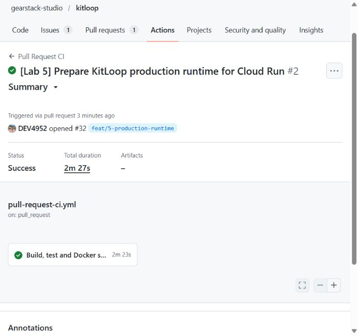
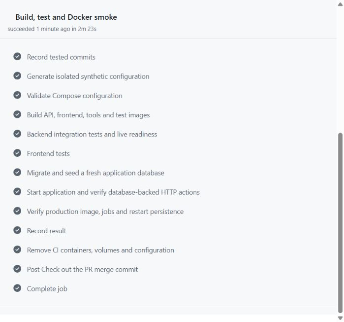
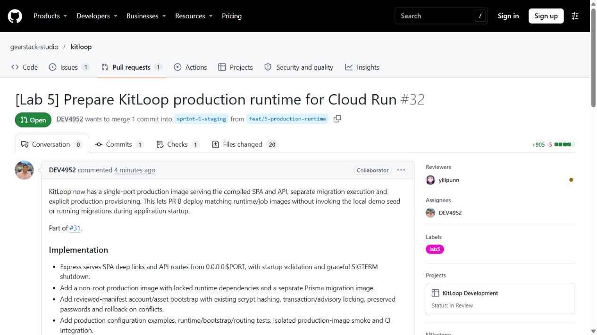

# PR A hosted CI and screenshots

PR: [#32](https://github.com/gearstack-studio/kitloop/pull/32). Part of [#31](https://github.com/gearstack-studio/kitloop/issues/31).

Captured from the actual GitHub pages on 2026-11-13 (Asia/Bangkok). The screenshots are unmodified browser captures. They show repository/PR metadata and public CI status, with no credentials or environment values displayed.

- Successful [implementation CI run](https://github.com/gearstack-studio/kitloop/actions/runs/43456008323).
- Tested PR head `f489ac2f5501322f6c01726b4fb5d2e911a3ddcb`.
- Tested merge SHA `47180386b99036cfbf1ad3ee3d3ce0d4bf5f3967`, verified from the checkout job log.
- Backend 70/70 and frontend 21/21 passed on the hosted Ubuntu runner.
- All production image, migration/bootstrap, restart persistence and expected failure-path checks passed.

Sanitized lines from the hosted job log:

```text
Tests 70 passed (70)
Tests 21 passed (21)
PASS production SPA/assets, health, readiness, Secure cookie, CSRF/origin, request write, role guard
PASS graceful SIGTERM shutdown with exit 0
PASS persisted session/request after restart, custodian checkout, active loan, availability and logout
PASS migration/configuration/bootstrap failure paths and production demo-seed guard
```

## CI summary



## CI steps



## Opened pull request



The later evidence-only commit adds these screenshots and documentation. It does not change the tested runtime code. Latest-head CI is linked in the PR separately. Actual GCP deployment, Cloud SQL connection and HTTPS browser evidence remain PR B responsibilities. Existing migration-tooling advisories and the earlier intermittent checkout finding are disclosed in `production-runtime-review.md` and the PR.
