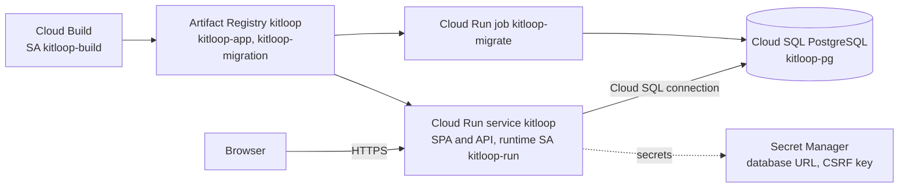
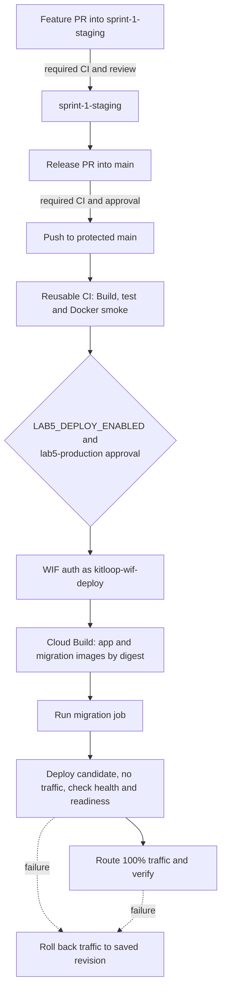

# Lab 5 requirement traceability matrix

Audit date: 16 November 2026, [Issue #49](https://github.com/gearstack-studio/kitloop/issues/49). Status labels follow the [evidence index](README.md#status-vocabulary).

The official handout and rubric are not stored in this repository. Rows use the requirement IDs quoted in the existing Lab 5 documents. R-03, R-05 and R-06 are not cited anywhere in the repository; map them against the handout before submission.

## Handout requirements and checks

| Requirement | Implementation | Evidence | Status | Remaining gap |
|:--|:--|:--|:--|:--|
| R-01, R-02: containerized build and local Compose run | [Dockerfile](../../../Dockerfile), [docker-compose.yml](../../../docker-compose.yml), PR [#28](https://github.com/gearstack-studio/kitloop/pull/28) | [C-03 record](c-03-evidence.md), [CI run 43263932716](https://github.com/gearstack-studio/kitloop/actions/runs/43263932716) | `PASS` | None for the build; see C-03 |
| R-04: data persists across restart and redeploy | Cloud SQL `kitloop-pg`, [verify.py](../../../infra/gcp/persistence/verify.py), PR [#41](https://github.com/gearstack-studio/kitloop/pull/41) | [Persistence register](evidence/persistence/README.md) | `PASS` | None |
| R-07: reviewed feature PR to staging, reviewed release PR to main | PRs [#39](https://github.com/gearstack-studio/kitloop/pull/39), [#45](https://github.com/gearstack-studio/kitloop/pull/45), release PR [#46](https://github.com/gearstack-studio/kitloop/pull/46) | Approving reviews on final heads | `PASS` | None |
| R-08: deploy only from main, revision traceable to commit | [deploy.yml](../../../.github/workflows/deploy.yml), [release.sh](../../../infra/gcp/release.sh) | [Run 43717180011 attempt 2](https://github.com/gearstack-studio/kitloop/actions/runs/43717180011/attempts/2), revision `kitloop-be72f87e15a6-20261115143840` | `PASS` | Registry tag is a 12-character SHA prefix; full SHA is recorded in evidence |
| R-09 to R-11: both teammates' issue, PR, review, test and deployment work | Issue and PR history | [Collaboration record](README.md#collaboration-record) | `PASS` | Confirm against the handout's exact per-person criteria |
| R-12: public repository | `gearstack-studio/kitloop` | [Repository page](https://github.com/gearstack-studio/kitloop), API `visibility: public` | `PASS` | None |
| C-01: PR build and tests | [pull-request-ci.yml](../../../.github/workflows/pull-request-ci.yml) | [Run 43618541536](https://github.com/gearstack-studio/kitloop/actions/runs/43618541536) and later PR runs | `PASS` | None |
| C-02: failing required CI blocks merge | Main required check; staging ruleset 27310627 | [Failing run 43683951193](https://github.com/gearstack-studio/kitloop/actions/runs/43683951193), [protection reads](README.md#branch-protection-observed-on-16-november-2026) | `PARTIAL` | No captured blocked merge; [isolated test](evidence-gaps.md#c-02-isolated-merge-gate-test) awaits approval |
| C-03: clean clone, Docker and configuration | `.env.example` files, Compose profiles | [C-03 record](c-03-evidence.md) | `PARTIAL` | Browser refresh check not recorded |
| C-04: public URL, sign-in, domain action, rejection | Cloud Run service `kitloop` | [baseline-ui.png](evidence/persistence/baseline-ui.png), [rejection probes](evidence/public-access/README.md) | `PASS` | Live role-based denial not run (CI covers it) |
| C-05: record survives restart and redeploy | As R-04 | [baseline](evidence/persistence/baseline.json), [restart](evidence/persistence/after-restart.json), [redeploy](evidence/persistence/after-redeploy.json) | `PASS` | None |
| C-06: reviewed main release, matching revision, visible change | As R-07 and R-08 | [Release evidence](README.md#production-release-evidence), [job log excerpt](evidence/deployment/release-run-43717180011-log-excerpt.txt) | `PARTIAL` | No visible change; [smallest visible release](evidence-gaps.md#c-06-smallest-visible-release) awaits approval |

## Episode implementation evidence

| Requirement | Implementation | Evidence | Status | Remaining gap |
|:--|:--|:--|:--|:--|
| E1: billing, budget and teammate access | GCP project `lab-5-cloud-deployment-514310` | [Free Trial, billing, budget and IAM screenshots](https://github.com/gearstack-studio/kitloop/issues/24#issuecomment-6853959906), [DEV4952 access confirmation](https://github.com/gearstack-studio/kitloop/issues/24#issuecomment-6855081953) | `PASS` | Screenshots are issue attachments, not repository files |
| E2: `/api/ready`, `0.0.0.0` and `PORT` binding, safe seeds | PR [#26](https://github.com/gearstack-studio/kitloop/pull/26) | Readiness 200 and 503 tests in every CI backend run | `COMPLETE` | None |
| E4: CI on pull requests | PR [#30](https://github.com/gearstack-studio/kitloop/pull/30) | [Run 43263932716](https://github.com/gearstack-studio/kitloop/actions/runs/43263932716) | `PASS` | None |
| E5: Artifact Registry, Cloud SQL, Secret Manager, first release | PRs [#32](https://github.com/gearstack-studio/kitloop/pull/32), [#33](https://github.com/gearstack-studio/kitloop/pull/33), [infra/gcp](../../../infra/gcp/README.md) | [public-readiness.json](evidence/persistence/public-readiness.json), [first deployment comment](https://github.com/gearstack-studio/kitloop/pull/41#issuecomment-6891599464) | `PASS` | First-release build ID and console screenshots not in repository |
| E5: Cloud SQL backups | `kitloop-pg` backup configuration | Backup `1794732111059`, completed 2026-11-15T08:43:12Z, in [baseline.json](evidence/persistence/baseline.json) | `PARTIAL` | Backup schedule and retention not documented with evidence |
| E6: GitHub OIDC and WIF without keys | PR [#36](https://github.com/gearstack-studio/kitloop/pull/36) | [WIF run 43611041165 attempt 3](https://github.com/gearstack-studio/kitloop/actions/runs/43611041165/attempts/3), [negative probes 43610138984](https://github.com/gearstack-studio/kitloop/actions/runs/43610138984), [IAM screenshots](evidence/iam/README.md) | `PASS` | None |
| E6: least-privilege IAM review | PR [#37](https://github.com/gearstack-studio/kitloop/pull/37) | [IAM review](wif-iam-merge-gates.md), [IAM screenshots](evidence/iam/README.md) | `PARTIAL` | Inherited-access analysis incomplete (evidence E2) |
| E6: staging merge gates | Ruleset 27310627 | [Ruleset history](evidence-gaps.md#staging-ruleset-history) | `PARTIAL` | Review rule removed at 15:45:00Z on 15 November and not restored |
| E7: dedicated deployment identity through WIF | `kitloop-wif-deploy`, provider `kitloop-github-deploy` | Release job step "Authenticate with the dedicated deployment identity": success | `PASS` | None |
| E7: Cloud Build and immutable digests | [release.sh](../../../infra/gcp/release.sh), [standalone build](episode-7-standalone-build.md) | Build `676619ea-a64f-4e49-89d5-cdb2a884a312` SUCCESS and digests in the [job log excerpt](evidence/deployment/release-run-43717180011-log-excerpt.txt) | `PASS` | None |
| E7: migration execution | `kitloop-migrate` job | Execution `kitloop-migrate-4d8sw` completed ([job log excerpt](evidence/deployment/release-run-43717180011-log-excerpt.txt)) | `PASS` | Pending-migration count is suppressed by the wrapper |
| E7: environment approval gate | `lab5-production` | Run approvals: DEV4952 approved | `PASS` | Screenshot not captured |
| E7: unauthorized deployment rejected | Trusted-job guard and WIF condition | Offline guard tests in CI; [Episode 6 negative probes](https://github.com/gearstack-studio/kitloop/actions/runs/43610138984) | `NOT VERIFIED` live | No live rejection run against the deployment provider |
| E7 and E8: rollback | `release.sh rollback`, automatic failure rollback step | CI rollback tests; [DEV4952 acceptance](https://github.com/gearstack-studio/kitloop/issues/38#issuecomment-6896877114) | `DEFERRED (Reviewer Approved)` | Live rollback and roll-forward not executed |

## Architecture and release pipeline

The diagrams describe resources named in [infra/gcp](../../../infra/gcp/README.md) and the observed release run. They are documentation sources, not captured console evidence.

