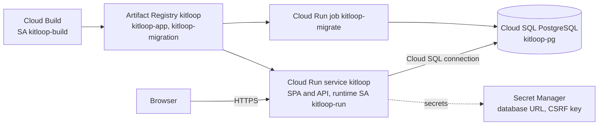
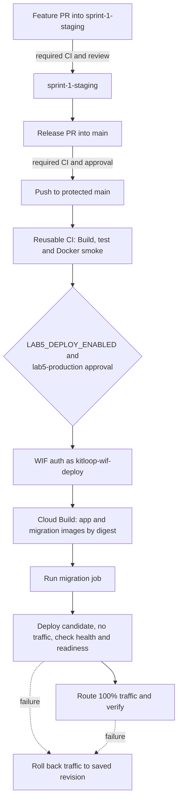

# Lab 5 requirement traceability matrix

Audit date: 16 November 2026, [Issue #49](https://github.com/gearstack-studio/kitloop/issues/49). Status labels follow the [evidence index](README.md#status-vocabulary).

Requirement wording follows the updated CPE 334 Lab 5 handout (`01_SE_Lab_5_updated.pdf`, Sections 4.1 and 8). The handout is course material and is not committed here. For checks, `PASS` means the behavior is verified; whether the handout's required evidence form exists is shown in the [evidence index](README.md#required-check-status).

## Handout requirements

| Requirement | Implementation | Evidence | Status | Remaining gap |
|:--|:--|:--|:--|:--|
| R-01: Docker image builds and runs from a clean clone | [Dockerfile](../../../Dockerfile), [docker-compose.yml](../../../docker-compose.yml), PR [#28](https://github.com/gearstack-studio/kitloop/pull/28) | [C-03 record](c-03-evidence.md), [CI run 43263932716](https://github.com/gearstack-studio/kitloop/actions/runs/43263932716) | `PASS` | None |
| R-02: settings from the environment, documented, no secret committed | `.env.example` files, [deployment.md](deployment.md) variable tables | [C-03 record](c-03-evidence.md), credential scans in [Issue #49](https://github.com/gearstack-studio/kitloop/issues/49) audit | `PASS` | None |
| R-03: public URL; domain workflow through UI, API and database | Cloud Run service `kitloop`, Cloud SQL `kitloop-pg` | [Baseline UI](evidence/persistence/baseline-ui.png), [persistence observations](evidence/persistence/README.md), [rejection probes](evidence/public-access/README.md) | `PASS` | Screenshots with the URL visible (C-04) |
| R-04: persistent database survives restart and redeploy | Cloud SQL `kitloop-pg`, [verify.py](../../../infra/gcp/persistence/verify.py), PR [#41](https://github.com/gearstack-studio/kitloop/pull/41) | [Persistence register](evidence/persistence/README.md) | `PASS` | After-phase UI screenshots (C-05) |
| R-05: build and tests on every relevant PR | [pull-request-ci.yml](../../../.github/workflows/pull-request-ci.yml) | [Run 43618541536](https://github.com/gearstack-studio/kitloop/actions/runs/43618541536) and later PR runs | `PASS` | None |
| R-06: passing check required; shown with a failing PR from a temporary branch | `main` protection; staging ruleset 27310627 | [PR #50 merge state](evidence/merge-gate/README.md#c-02-disposable-failing-ci-test), [failed run 43819010572](https://github.com/gearstack-studio/kitloop/actions/runs/43819010572) | `PASS` | Blocked-merge screenshot; missing approval was a second blocker |
| R-07: release from main through review, CI, merge, deployment | [deploy.yml](../../../.github/workflows/deploy.yml), PR [#45](https://github.com/gearstack-studio/kitloop/pull/45), release PR [#46](https://github.com/gearstack-studio/kitloop/pull/46) | [Run 43717180011 attempt 2](https://github.com/gearstack-studio/kitloop/actions/runs/43717180011/attempts/2) with environment approval | `PASS` | None |
| R-08: identify each release commit; documented release procedure | [release.sh](../../../infra/gcp/release.sh), [deployment.md](deployment.md#find-the-running-commit) | Revision `kitloop-be72f87e15a6-20261115143840`, [job log excerpt](evidence/deployment/release-run-43717180011-log-excerpt.txt) | `PASS` | Registry tag is a 12-character SHA prefix; the full SHA is recorded in the run |
| R-09: issues, board, branches, teammate-reviewed PRs, release PR; specific reviews | Issue and PR history | [Collaboration record](README.md#collaboration-record), [collaboration log](GITHUB-COLLABORATION-LOG.md) | `PARTIAL` | Four approvals state no specific check or finding |
| R-10: `lab5` labels; history kept | Labels; no rewritten history | [Collaboration record](README.md#collaboration-record) | `PASS` | PRs #26, #44, #45 and #46 were labelled retroactively on 2026-11-16 at 08:08 UTC |
| R-11: both members take part in every activity | Issue and PR authorship and review | [Collaboration log](GITHUB-COLLABORATION-LOG.md#collaboration-patterns) | `PASS` | None |
| R-12: public repository | `gearstack-studio/kitloop` | [Repository page](https://github.com/gearstack-studio/kitloop), API `visibility: public` | `PASS` | None |

## Handout checks

| Check | Covers | Evidence | Behavior | Remaining gap |
|:--|:--|:--|:--|:--|
| C-01: normal PR runs build and all tests, which pass | R-05 | [Run 43618541536](https://github.com/gearstack-studio/kitloop/actions/runs/43618541536) | `PASS` | None |
| C-02: failing PR from a temporary branch cannot be merged | R-06 | [PR #50 evidence](evidence/merge-gate/README.md#c-02-disposable-failing-ci-test) | `PASS` | Merge-button screenshot; causes not isolated |
| C-03: fresh clone builds and runs with `.env.example` values | R-01, R-02 | [C-03 record](c-03-evidence.md) | `PASS` | None |
| C-04: sign-in, main action and one rejection on the public URL | R-03 | [Baseline UI](evidence/persistence/baseline-ui.png), [rejection probes](evidence/public-access/README.md) | `PASS` | Screenshots with the URL visible |
| C-05: record survives restart and redeploy | R-04 | [baseline](evidence/persistence/baseline.json), [restart](evidence/persistence/after-restart.json), [redeploy](evidence/persistence/after-redeploy.json) | `PASS` | After-phase screenshots |
| C-06: reviewed change from staging to main, deployed, revision matches commit | R-07 to R-10 | PRs [#45](https://github.com/gearstack-studio/kitloop/pull/45) and [#46](https://github.com/gearstack-studio/kitloop/pull/46), [release evidence](README.md#production-release-evidence) | `PASS` | Step 7 visible change (not part of C-06) |

## Episode implementation evidence

| Requirement | Implementation | Evidence | Status | Remaining gap |
|:--|:--|:--|:--|:--|
| E1: billing, budget and teammate access | GCP project `lab-5-cloud-deployment-514310` | [Free Trial, billing, budget and IAM screenshots](https://github.com/gearstack-studio/kitloop/issues/24#issuecomment-6853959906), [DEV4952 access confirmation](https://github.com/gearstack-studio/kitloop/issues/24#issuecomment-6855081953) | `PASS` | Screenshots are issue attachments, not repository files |
| E2: `/api/ready`, `0.0.0.0` and `PORT` binding, safe seeds | PR [#26](https://github.com/gearstack-studio/kitloop/pull/26) | Readiness 200 and 503 tests in every CI backend run | `COMPLETE` | None |
| E4: CI on pull requests | PR [#30](https://github.com/gearstack-studio/kitloop/pull/30) | [Run 43263932716](https://github.com/gearstack-studio/kitloop/actions/runs/43263932716) | `PASS` | None |
| E5: Artifact Registry, Cloud SQL, Secret Manager, first release | PRs [#32](https://github.com/gearstack-studio/kitloop/pull/32), [#33](https://github.com/gearstack-studio/kitloop/pull/33), [infra/gcp](../../../infra/gcp/README.md) | [public-readiness.json](evidence/persistence/public-readiness.json), [first deployment comment](https://github.com/gearstack-studio/kitloop/pull/41#issuecomment-6891599464) | `PASS` | First-release build ID and console screenshots not in repository |
| E5: Cloud SQL backups | `kitloop-pg` backup configuration | Backup `1794732111059`, completed 2026-11-15T08:43:12Z, in [baseline.json](evidence/persistence/baseline.json) | `PARTIAL` | Backup schedule and retention not documented with evidence |
| E6: GitHub OIDC and WIF without keys | PR [#36](https://github.com/gearstack-studio/kitloop/pull/36) | [WIF run 43611041165 attempt 3](https://github.com/gearstack-studio/kitloop/actions/runs/43611041165/attempts/3), [negative probes 43610138984](https://github.com/gearstack-studio/kitloop/actions/runs/43610138984), [IAM screenshots](evidence/iam/README.md) | `PASS` | None |
| E6: least-privilege IAM review | PR [#37](https://github.com/gearstack-studio/kitloop/pull/37) | [IAM review](wif-iam-merge-gates.md), [IAM screenshots](evidence/iam/README.md) | `PARTIAL` | Inherited-access analysis incomplete (evidence E2) |
| E6: staging merge gates | Ruleset 27310627 | [Restoration read-back](evidence/merge-gate/README.md#staging-ruleset-restoration), [ruleset history](evidence-gaps.md#staging-ruleset-history) | `PASS` | Rule was absent from 15 Nov 13:26Z to 13:57Z and 15:45Z to 16 Nov 06:42Z |
| E7: dedicated deployment identity through WIF | `kitloop-wif-deploy`, provider `kitloop-github-deploy` | Release job step "Authenticate with the dedicated deployment identity": success | `PASS` | None |
| E7: Cloud Build and immutable digests | [release.sh](../../../infra/gcp/release.sh), [standalone build](episode-7-standalone-build.md) | Build `676619ea-a64f-4e49-89d5-cdb2a884a312` SUCCESS and digests in the [job log excerpt](evidence/deployment/release-run-43717180011-log-excerpt.txt) | `PASS` | None |
| E7: migration execution | `kitloop-migrate` job | Execution `kitloop-migrate-4d8sw` completed ([job log excerpt](evidence/deployment/release-run-43717180011-log-excerpt.txt)) | `PASS` | Pending-migration count is suppressed by the wrapper |
| E7: environment approval gate | `lab5-production` | Run approvals: DEV4952 approved | `PASS` | Screenshot not captured |
| E7: unauthorized deployment rejected | Trusted-job guard and WIF condition | Offline guard tests in CI; [Episode 6 negative probes](https://github.com/gearstack-studio/kitloop/actions/runs/43610138984) | `NOT VERIFIED` live | No live rejection run against the deployment provider |
| E7 and E8: rollback | `release.sh rollback`, automatic failure rollback step | CI rollback tests; [DEV4952 acceptance](https://github.com/gearstack-studio/kitloop/issues/38#issuecomment-6896877114) | `DEFERRED (Reviewer Approved)` | Live rollback and roll-forward not executed |

## Architecture and release pipeline

The diagrams describe resources named in [infra/gcp](../../../infra/gcp/README.md) and the observed release run. They are documentation sources, not captured console evidence.

