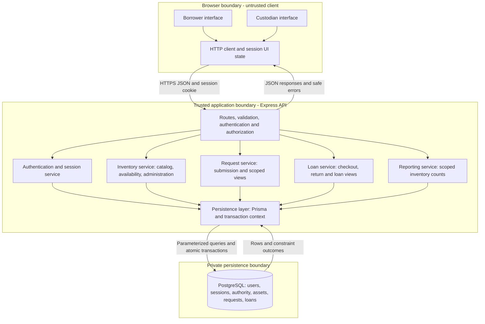
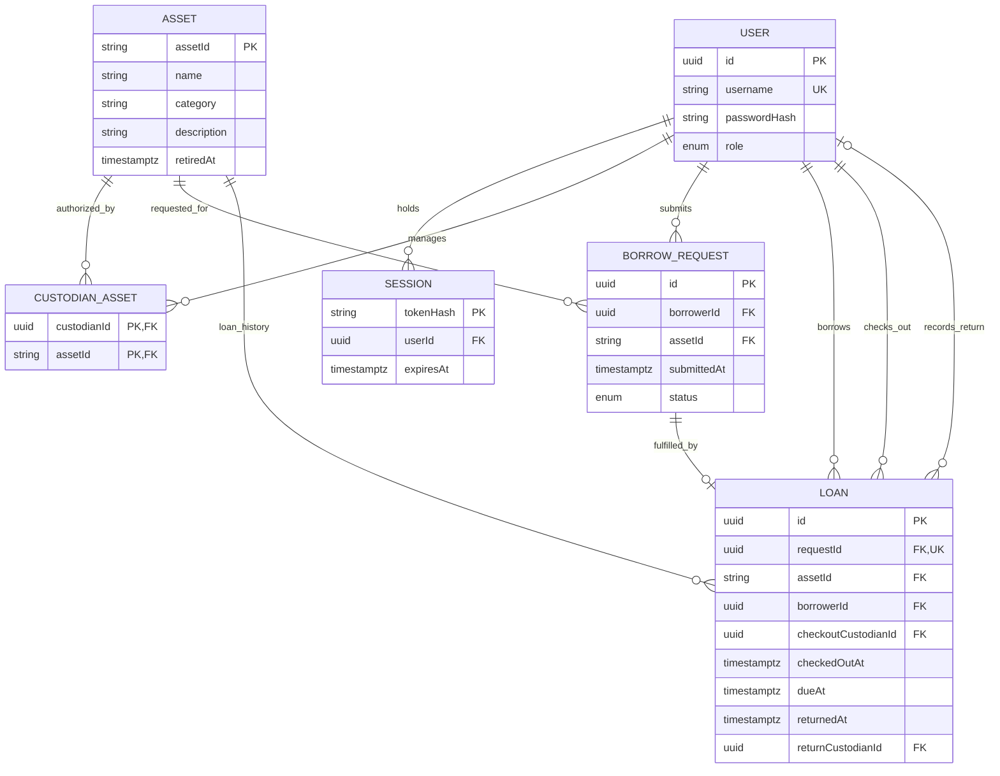

# KitLoop System-Level Software Design Specification

**Status:** Proposed design; review by both team members pending.

**Baseline:** `sprint-1-staging` revision `881c4d6`, 2026-11-02.

**Requirements:** [SRS](srs.md), [Feature Inventory](feature-inventory.md), and [Requirements Traceability Matrix (RTM)](traceability-matrix.md).

## 1. Purpose, scope, and implementation status

This SDS defines the system architecture, component contracts, data relationships, workflows, and security boundaries for the mandatory three-sprint product. The SRS controls observable behavior and sprint allocation. This document proposes implementation choices within that scope; it does not claim stakeholder approval or completed implementation.

At the baseline, `client/` contains a React/TypeScript/Vite scaffold. `server/` contains an Express/TypeScript scaffold, a localhost CORS configuration, JSON parsing, and `GET /api/health`, with a health test. Authentication, domain endpoints, Prisma models, database constraints, and transaction behavior described below are planned. They are not present in the baseline. Endpoint names are proposed system contracts to refine in implementation PRs.

The product has Borrower and Custodian roles. Each asset represents one physical copy. A pending request expresses intent without reservation. Custodian checkout fulfills a request and creates a loan; return closes that loan. There is no approval stage. Optional features excluded by the SRS, including cancellation, notifications, fines, scanning, and automatic allocation, are not introduced here.

## 2. Architecture and deployment boundaries

Use a layered **modular monolith**: one React web client, one Express API process containing domain modules, and one PostgreSQL database accessed through Prisma. A two-person team can implement and test custody changes in one database transaction without distributed coordination. Modules have distinct responsibilities but share the same deployment and transaction boundary.



Arrows show logical calls and data flow, not separate microservices. Server responses carry only authorized DTO fields. The browser never connects to PostgreSQL or receives database credentials. For production, propose a single public origin serving the built client and forwarding `/api` to Express over HTTPS. Static serving/reverse proxy and hosting are deployment choices pending SRS OQ-05. Local development retains Vite on port 5173 and Express on port 3000 with an explicit development origin allowlist.

Controllers parse input and serialize responses; services enforce domain policy; persistence functions accept the current transaction context. A service must not commit independently inside a checkout/return transaction. Shared availability and scope predicates are reused by catalog, checkout, retirement, and reporting so these views cannot implement competing definitions.

## 3. Components, responsibilities, and interfaces

| Component | Responsibilities | Inputs and outputs / collaborators | Feature ownership |
| --- | --- | --- | --- |
| Borrower interface | Sign-in/logout, catalog, request submission, personal requests and loans, due/overdue presentation. | Calls public JSON contracts using the current session; renders server state and validation/conflict messages. | FEAT-01, FEAT-02, FEAT-03, FEAT-05 |
| Custodian interface | Scoped pending queue, physical checkout/return forms, asset maintenance, inventory summary. | Sends request/loan/asset identifiers and due date; refreshes affected views after committed mutations. | FEAT-01, FEAT-03, FEAT-04, FEAT-06, FEAT-07 |
| API boundary | Route dispatch, schema validation, session/role checks, safe error mapping. | Validated DTO and server-derived principal into services; sanitized JSON out. Does not trust client identity/role fields. | Cross-cutting |
| Authentication and RBAC | Verify seeded credentials, create/revoke sessions, resolve current user and role; shared ownership/scope checks. | User/session persistence; principal `{ userId, role }`; domain services additionally enforce record-level authority. | FEAT-01 |
| Inventory service | Catalog/search/filter, canonical availability, unique asset creation, detail changes, safe retirement. | Asset and active-loan queries; authorized inventory scope for writes; supplies reusable availability predicate. | FEAT-02, FEAT-07 |
| Request service | Submit pending requests, personal request views, custodian pending queue. | Principal and Asset ID; stores server-derived requester/time; reads asset state; never creates loans. | FEAT-03 |
| Loan service | Transactional checkout/return, loan persistence and personal loan views, derived overdue status. | Principal, request/loan ID, due date; inventory and request persistence in the same transaction. | FEAT-04, FEAT-05 |
| Reporting service | Count authorized assets by the same state predicates used by the catalog. | Scoped aggregate query; returns total, available, checkedOut, retired counts. | FEAT-06 |
| Persistence layer | Prisma queries, transaction context, migrations, synthetic seeds, constraint error translation. | PostgreSQL only; no browser access; returns domain data rather than raw database errors. | All features |

### Proposed HTTP contracts

All paths are under `/api`. JSON uses explicit response DTOs, ISO 8601 timestamps with timezone, and stable identifiers. List queries apply access scope in the database query. Direct-ID operations repeat ownership/scope checks; list filtering alone is not authorization.

| Method and path | Access / input | Success result | First sprint / FR |
| --- | --- | --- | --- |
| POST `/auth/login` | Seeded username and password; unauthenticated entry point | 200 user identifier/role and new session cookie | 1 / FR-01 |
| POST `/auth/logout` | Authenticated session and CSRF protection | 204, server session revoked and cookie cleared | 1 / FR-02 |
| GET `/auth/me` | Authenticated | 200 current identifier/role | 1 / FR-03 |
| GET `/assets` | Either authenticated role; later search/name/Asset ID and category/availability filters | 200 catalog DTOs with canonical availability | 1 / FR-04, FR-05; 3 / FR-16 |
| POST `/requests` | Borrower; `{ assetId }` | 201 pending request with ID, asset, requester, submission time, status | 1 / FR-06 |
| GET `/requests/mine` | Borrower | 200 own requests with asset/status | 1 / FR-07 |
| GET `/requests/pending` | Custodian | 200 pending requests joined to authorized assets and necessary requester details | 2 / FR-08 |
| POST `/requests/:requestId/checkout` | Custodian; `{ assetId, dueAt }`; asset must match request | 201 persisted loan and fulfilled request reference | 2 / FR-09, FR-10 |
| GET `/loans/mine` | Borrower | 200 own active/returned loan DTOs with applicable timestamps; overdue flag added in Sprint 3 | 2 / FR-11; 3 / FR-13 |
| GET `/loans/active` | Custodian | 200 active loans for authorized assets, with due dates and later overdue flag; supports return selection | 2 / FR-12 support; 3 / FR-13 |
| POST `/loans/:loanId/return` | Custodian | 200 closed loan with return time and refreshed asset availability | 2 / FR-12 |
| POST `/assets` | Custodian; required Asset ID, name, category, description | 201 created asset within creator's seeded authority model | 3 / FR-14 |
| PATCH `/assets/:assetId` | Authorized Custodian; catalog details only | 200 updated asset; identity/custody fields cannot be edited | 3 / FR-15 |
| POST `/assets/:assetId/retire` | Authorized Custodian; no active loan | 200 retired asset, non-borrowable | 3 / FR-15 |
| GET `/inventory/summary` | Custodian | 200 counts for authorized assets only | 3 / FR-17 |
| GET `/health` | Public; no private data | Existing 200 service health response | Existing scaffold; deployment smoke support |

No generic write endpoint can set a loan's return time, request status, borrower, authority, or availability directly. Proposed paths above do not introduce approval, cancellation, assignment administration, or new roles. Custodian active-loan listing is an interface supporting the required return workflow, not a new feature.

Use 400 for malformed/missing input, 401 for absent/ended sessions, 403 for an authenticated wrong role, 404 for missing or inaccessible foreign records, and 409 for state conflicts (unavailable asset, non-pending request, repeated return, duplicate Asset ID, or retirement while loaned). Invalid due dates produce 400. Error bodies use `{ error: { code, message, fields? } }`; unexpected failures use a generic 500 with no SQL, stack trace, credentials, or internal paths. These are proposed conventions for NFR-01–NFR-04. A 409 prompts the UI to refresh state and show the conflict, never silently choose another asset/request.

## 4. High-level data model



Role is one required enum on User: `BORROWER` or `CUSTODIAN`. A separate Role table is unnecessary for two fixed roles. CustodianAsset is a many-to-many authority relation with composite primary key `(custodianId, assetId)`; only Custodian users may receive assignments. BorrowRequest status is `PENDING` or `FULFILLED`. Nullable `retiredAt`, `returnedAt`, and `returnCustodianId` are absent until their corresponding event. A request has zero or one loan; an asset and borrower can each have many historical loans. User foreign keys on Loan have distinct meanings, shown separately above.

Checkout records are represented by Loan's immutable request, asset, borrower, custodian, and checkout/due timestamps. No second checkout table duplicates that event. Return records add the return timestamp and actor to the same loan. Preserve referenced users/assets/requests and loan history rather than hard-deleting them through application endpoints.

### Invariants and derived state

| Invariant | Proposed enforcement |
| --- | --- |
| Asset ID identifies one physical copy | Asset primary key; immutable through catalog editing. Duplicate creation rejected. |
| At most one active loan per asset (BR-02, BR-09) | PostgreSQL partial unique index on `Loan(assetId)` where `returnedAt IS NULL`, installed by a SQL migration. Prisma query checks alone are insufficient. |
| At most one checkout per request | Unique `Loan.requestId`; transactional request transition. |
| Loan refers to the requested asset and borrower (BR-06) | Server derives borrower from the request and verifies supplied asset matches; propose a composite foreign key from Loan `(requestId, assetId, borrowerId)` to a matching unique tuple on BorrowRequest. |
| Valid timestamps (BR-07, BR-11) | Database checks `dueAt > checkedOutAt`, `returnedAt IS NULL OR returnedAt >= checkedOutAt`, and return timestamp/actor nullability together; server validation supplies useful errors. |
| Only a matching pending request becomes fulfilled | Atomic checkout transaction; no standalone status update API. |
| No retirement during active custody | Retirement takes the same asset-row lock as checkout/return and checks for an active loan before writing. |
| Authority belongs to a Custodian | Seed/service validation of role, plus scoped queries on every operation; assignments have no client write interface. |

Prisma migrations define ordinary keys/relations. Custom migration SQL supplies the partial index and checks where needed; implementation must verify constraints against PostgreSQL, not only mocked repositories.

Canonical asset state is derived from stored facts: `RETIRED` if `retiredAt` exists, otherwise `CHECKED_OUT` if an active loan exists, otherwise `AVAILABLE`. A valid database state cannot be both retired and actively loaned. Only `AVAILABLE` is borrowable. Do not store an independently editable availability boolean. Catalog reads and checkout use the same predicate; pending requests do not affect it (BR-08, BR-10, BR-13).

Loan state is `ACTIVE` when `returnedAt` is null, otherwise `RETURNED`. Overdue is derived at response time as `returnedAt IS NULL AND serverNow > dueAt`; equality is not overdue (BR-12). Store instants as timezone-aware timestamps and serialize UTC; the client may localize display. A controlled server clock supports boundary tests. No overdue scheduler or additional loan status is required.

Summary counts use the canonical mutually exclusive asset states and the same authorized asset set, in one database query/snapshot: `total = available + checkedOut + retired`. Retired assets remain visible in an authorized inventory report; borrowable catalog results exclude them. Default borrower catalog visibility provisionally shows available and checked-out assets pending OQ-04.

## 5. Main workflows and transaction boundaries

### 5.1 Authentication and authorization

1. Browser submits seeded credentials to login. The server validates input and compares a salted password hash; invalid credentials return a generic error without creating a session.
2. On success, generate a cryptographically random opaque session token; store only its hash with user and expiry in PostgreSQL. Send the token through an HttpOnly session cookie. Rotate the token on sign-in.
3. For each protected call, middleware resolves the session, checks expiry, and obtains identity/role from server records. The service then applies borrower ownership or custodian asset authority. UI navigation is only presentation.
4. Logout deletes the server session and clears the cookie. Reusing the token fails authentication. A changed/revoked role or authority must take effect through fresh server lookups, not trusted stale client role data.

This proposed server-session design provides real logout invalidation for FR-02 without an additional token revocation subsystem. Session expiry duration is an implementation configuration to document and test; it does not decide borrowing duration.

### 5.2 Equipment availability

Catalog query joins assets to active-loan existence and derives canonical state. Sprint 3 search/filter parameters are validated and combined with these predicates. Results include asset identity/details and availability. A displayed available asset may be checked out by another request immediately afterward; checkout must revalidate inside its transaction. Client caches never authorize custody changes.

### 5.3 Borrowing request submission

Authenticate a Borrower and validate Asset ID. Within a short serializable transaction, read the asset and active-loan count and confirm it is borrowable using the canonical predicate. Reject an existing pending request for the same borrower and asset; otherwise insert a pending request with the session user's ID and server submission time, commit, and return it. Retry serialization conflicts a bounded number of times, revalidating all conditions. A PostgreSQL partial unique index on `(borrowerId, assetId)` where status is `PENDING` independently prevents duplicate pending requests. Different borrowers may create distinct pending requests for the same available asset. Do not write a loan, change availability, or enforce a one-pending-request-per-asset uniqueness rule. Personal views query `borrowerId = principal.userId` (FR-06, FR-07; BR-04, BR-10). This is the FEAT-03 implementation refinement; checkout/return locking elsewhere in this SDS remains the proposed custody design.

### 5.4 Checkout and loan creation

```mermaid
sequenceDiagram
    actor C as Authorized Custodian
    participant UI as Custodian UI
    participant API as API and Loan Service
    participant DB as PostgreSQL transaction
    C->>UI: Confirm handoff, request, asset and due date
    UI->>API: POST request checkout
    API->>API: Validate session, role and input
    API->>DB: Begin; lock asset, then request
    API->>DB: Recheck authority, availability and pending request match
    alt Valid transition
        API->>DB: Insert loan and fulfill request
        API->>DB: Commit
        API-->>UI: 201 loan and fulfilled request
    else Conflict or validation failure
        API->>DB: Roll back
        API-->>UI: Safe error; no partial transition
    end
```

The service first resolves the request's asset without treating the initial read as authorization, then locks that asset row and the request row in a consistent order. In the transaction it rechecks current custodian authority, pending request status, matching supplied Asset ID, non-retired available state, and `dueAt > checkedOutAt` using server time. Borrower and request references come from persisted request data. Insert the loan and change request status to fulfilled in the same transaction. Commit before sending success.

All custody/retirement operations lock the asset first; concurrent attempts for the same asset serialize. The second checkout sees an active loan and receives 409; its request remains pending. The partial unique index is a final guard against duplicate active loans even if a code path misses the lock. Known uniqueness/serialization conflicts are translated safely; any failure rolls back both loan and request changes (BR-01, BR-02, BR-05, BR-06, BR-08, BR-09, BR-11; NFR-05, NFR-06). No automatic retry may select another request or duplicate a successful checkout.

### 5.5 Return and availability update

Resolve the loan's immutable Asset ID; begin a transaction, lock asset then loan, and recheck the Custodian's authority and that `returnedAt` is null. Set server return time and returning custodian exactly once. Commit, then return the closed loan and recomputed asset state. No active loan remains, so the non-retired asset is available without a separate availability write. A repeated return receives 409 and preserves the original return timestamp. Failure leaves the loan active and availability unchanged. Borrowers cannot return equipment through their API role (BR-03, BR-05, BR-07, BR-08).

### 5.6 Inventory maintenance, loan views, and reporting

An authorized asset-create transaction inserts catalog details and the creator's CustodianAsset assignment together. This is a proposed demo treatment of OQ-02, subject to the department owner's decision; it does not let the creator assign other existing assets. Editing checks authority and accepts catalog fields only. Retirement locks the asset and rejects active loans before setting `retiredAt`; reactivation is outside the defined API.

Borrower loan views always filter by the signed-in borrower. Custodian active-loan and request views join authority before projection of requester details. Sprint 3 adds due/overdue presentation and computes inventory summaries from the scoped canonical state query. These reads do not mutate custody or request state.

## 6. Security boundaries and access matrix

| Capability | Unauthenticated | Borrower | Custodian |
| --- | --- | --- | --- |
| Health / credential submission | Allowed | Allowed | Allowed |
| Current identity / logout | Denied | Own session | Own session |
| Catalog / search | Denied (proposed authenticated catalog) | Catalog policy above | Catalog policy above |
| Submit request | Denied | As self only | Denied |
| Personal requests / loans | Denied | Own records only | Denied borrower endpoints |
| Pending queue / active-loan management views | Denied | Denied | Authorized assets only |
| Checkout / return | Denied | Denied | Authorized assets only |
| Create / edit / retire inventory | Denied | Denied | Creator assignment on create; authorized assets on edit/retire |
| Inventory summary | Denied | Denied | Authorized assets only |

The shared catalog is an intentional discovery projection for both authenticated roles. Custodian management views, requester details, mutations, and reports are restricted to authorized assets (BR-05). Confirm this catalog-versus-management interpretation during OQ-02 review; no private borrowing details belong in catalog DTOs.

Treat the browser, route parameters, JSON, and query strings as untrusted. Reject attempts to supply role, borrower identity, custody state, return time, or authority through write payloads. Validate required fields, lengths, identifiers, and timestamps at the API boundary. Use parameterized persistence queries and explicit response field allowlists. Return 404 for inaccessible record IDs to avoid disclosing another user's records; authentication and role failures remain 401/403.

Production cookies use `HttpOnly`, `Secure`, and `SameSite=Lax`; state-changing authenticated requests require an anti-CSRF token bound to the session and trusted-origin validation. The login boundary also validates origin. SameSite/CORS alone are not authorization. Local cookie/CORS settings must explicitly support the two development origins with credentials, and production must allow only the intended origin. The baseline CORS scaffold is not evidence that this is implemented.

Keep database connection strings and authentication configuration in ignored environment files; provide placeholder examples without real secrets. Only the API receives database credentials. Use a restricted runtime database account and a separate migration capability where supported. Log operational IDs and outcomes without credentials/session tokens/passwords; client errors contain no database internals. Seed only synthetic equipment and demo users with hashed passwords (NFR-01–NFR-04).

## 7. Architectural decisions, assumptions, and constraints

| Decision | Rationale and consequence |
| --- | --- |
| One API deployment with domain modules | Fits the two-person, three-sprint constraint and permits local ACID transactions; no queues, microservices, or distributed locks are required. |
| PostgreSQL with Prisma | Follows the SRS stack. Transaction tests and custom SQL constraints must run on PostgreSQL; an in-memory substitute cannot demonstrate concurrency correctness. |
| Derived availability and overdue | Prevents duplicate editable state; all readers and mutations share definitions and server time. |
| Opaque revocable server sessions | Supports logout and server-derived roles; requires session persistence and cookie/CSRF configuration. |
| Asset locks plus database constraints | Serializes custody/retirement changes and independently prevents duplicate active loans. Keep transactions short and acquire asset before request/loan. |
| Explicit seeded asset authority | Implements the provisional OQ-02 treatment; no assignment-management UI or new administrator role is assumed. |
| Preserve loan/request history | Maintains asset/request/borrower/custodian traceability; catalog editing cannot rewrite custody evidence. |
| No separate approval or reservation | Preserves AD-03/AD-04 and allows competing pending requests. Only successful checkout chooses a borrower. |

SRS AD-01–AD-07 remain in force. OQ-01 (loan period) remains with the department owner/instructor: accept only a future due date until policy is agreed before Sprint 2 acceptance. OQ-02 (authority model) remains with the department owner/project team: review seeded assignment and creator assignment before Sprint 2 authorization acceptance. OQ-03 does not add cancellation/expiration. Resolve OQ-04's retired catalog display policy before Sprint 3 search acceptance and OQ-05's hosting/evidence requirements before deployment verification. No hosting provider, production load target, backup service, or instructor approval is assumed.

Deployment work must document actual prerequisites, environment examples, migration/seed, build/start, and test commands. Apply reviewed migrations before starting the dependent API version, keep the database private, and record a clean-checkout reproduction and deployed smoke path. This SDS does not claim the baseline server build script produces a runnable deployment artifact; implementation must supply and verify the start/build arrangement (NFR-07, NFR-08).

## 8. Requirement alignment and verification plan

| Feature | Design coverage | FR | Principal BR | First verification |
| --- | --- | --- | --- | --- |
| FEAT-01 | Authentication/session service, API boundary, access matrix | FR-01, FR-02, FR-03 | BR-03, BR-04, BR-05 | Sprint 1; extend with later operations |
| FEAT-02 | Inventory service, derived availability, catalog contract | FR-04, FR-05, FR-16 | BR-08, BR-13 | Sprint 1 catalog; Sprint 3 search |
| FEAT-03 | Request service, request workflow, scoped views | FR-06, FR-07, FR-08 | BR-03, BR-04, BR-05, BR-06, BR-10, BR-13 | Sprint 1 submission/personal view; Sprint 2 queue |
| FEAT-04 | Loan service, asset locks, atomic checkout/return, constraints | FR-09, FR-10, FR-12 | BR-01, BR-02, BR-03, BR-05, BR-06, BR-07, BR-08, BR-09, BR-11, BR-13 | Sprint 2 |
| FEAT-05 | Loan views, derived due/overdue, ownership queries | FR-11, FR-13 | BR-03, BR-04, BR-12 | Sprint 2 loan view; Sprint 3 overdue |
| FEAT-06 | Scoped single-snapshot aggregate query | FR-17 | BR-03, BR-05, BR-08, BR-13 | Sprint 3 |
| FEAT-07 | Inventory creation/edit/retirement, authority and locks | FR-14, FR-15 | BR-02, BR-03, BR-05, BR-13 | Sprint 3 |

The RTM remains the canonical planned test catalog. This design supplies the following implementation/test seams without claiming test execution:

- **Sprint 1:** TC-01–TC-07, TC-18, TC-21–TC-24 verify seeded identity/logout, catalog, request ownership/non-reservation, authentication boundaries, password/config inspection, input validation, and safe internal failures (NFR-01–NFR-04).
- **Sprint 2:** TC-08–TC-12, TC-19, TC-20, TC-25, TC-26 verify scoped custody, concurrent checkout against PostgreSQL, rollback with injected failure, duplicate active-loan constraints, persistence/restart, and clean-checkout reproduction (NFR-05–NFR-07). Repeat earlier security cases on new operations.
- **Sprint 3:** TC-13–TC-17, TC-27, TC-28 verify strict overdue time boundaries, scoped administration/search/summary consistency, deployment smoke, and full BR regression coverage (NFR-08, NFR-09).

In particular, test simultaneous checkout of different pending requests for one asset, checkout versus retirement, repeated return, foreign request/loan IDs, and failures between related writes. Verify database state after rejection. A rendered UI or health response alone cannot establish these invariants.

## 9. Review and completion record

| Gate | Status | Evidence required |
| --- | --- | --- |
| System design draft | Prepared | This document, architecture/data diagrams, and baseline reference |
| Team member 1 review | Pending | Name, date, PR review URL, and resolved comments |
| Team member 2 review | Pending | Name, date, PR review URL, and resolved comments |
| Reviewed PR | Pending | PR URL, approvals/review records, and merge commit |

Both team members should review component boundaries, SRS/feature coverage, scope/ownership enforcement, transaction failure and concurrency behavior, proposed HTTP/session contracts, and provisional policy decisions. Record actual reviews in the PR before marking these gates complete. This draft does not substitute an automated check for teammate review. If a decision changes, update this SDS and the affected SRS, feature inventory, RTM, and implementation plan together.
